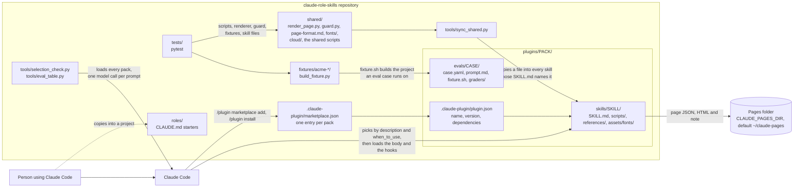

# Container view

The parts of the repository, how a pack reaches Claude Code and how the shared files reach each skill. Every box is a
folder or file in the repository, except Claude Code and the pages folder.

