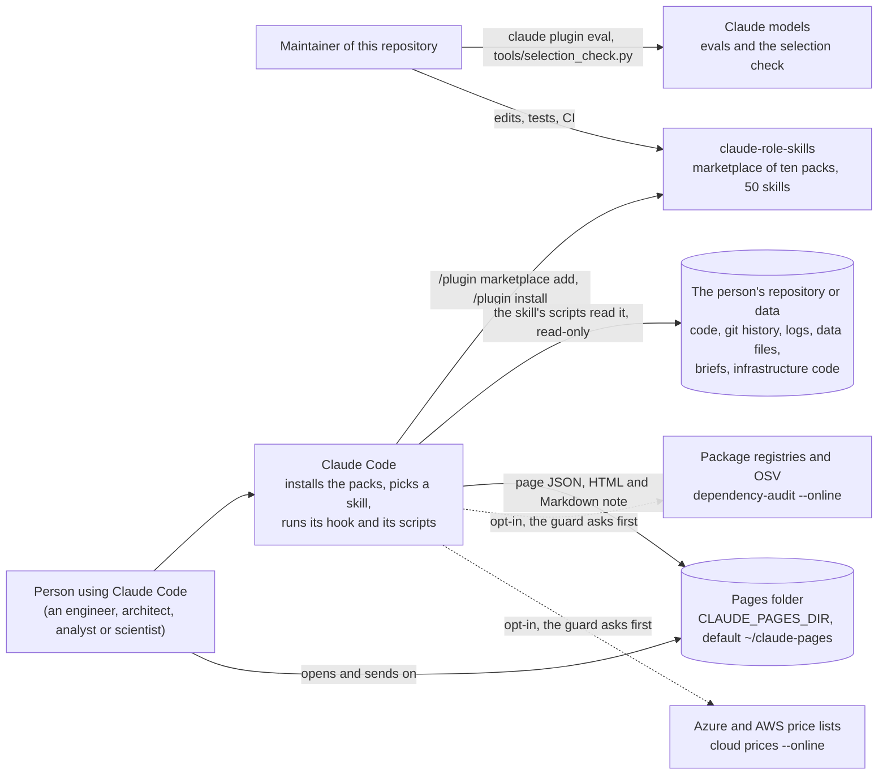

# Context view

Who uses the skills, what they run in and what they reach. The parts inside the repository are in the
[container view](container.md).

- Nothing in the repository runs as a service. The scripts run on the person's machine with `python3` and the
  standard library.
- The only outbound calls are opt-in: `--online` in `plugins/software-engineering/skills/dependency-audit/scripts/deps.py`
  (OSV, PyPI, npm, NuGet) and in `shared/cloud_prices.py` (the endpoints in `shared/cloud/PROVIDER.json`). Every one
  has a timeout, and the guard asks before any of them during the skill's turn.
- The evals and the selection check start real Claude sessions through the `claude` CLI; the skills themselves call
  no model.
