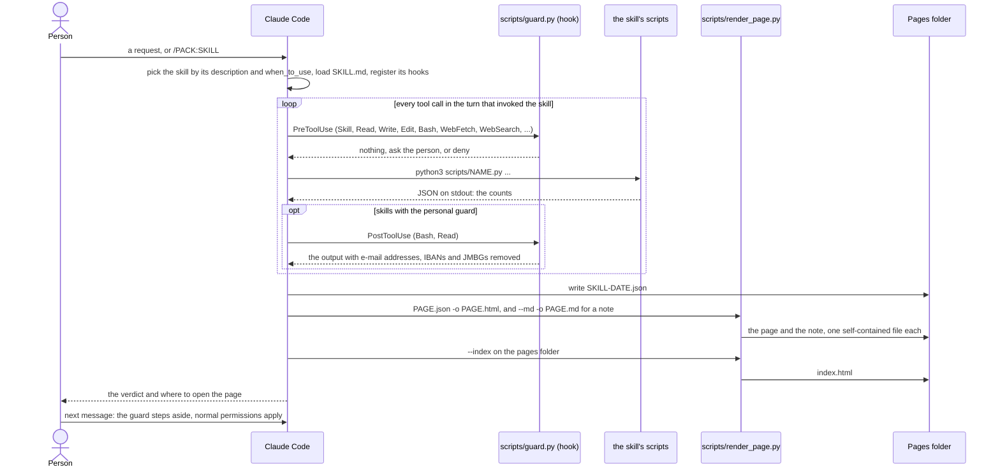

# A skill run

What happens from a request to the page, with the guard hook on every tool call during the skill's turn. The data
skills (guard called with `personal`) also pass Bash and Read output through the guard after the call.

