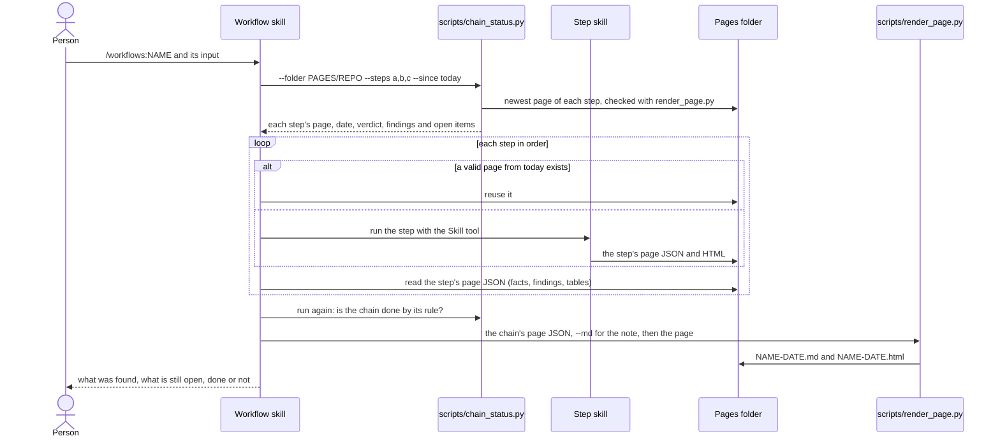

# A workflow chain

How a workflow skill runs its steps. Each step is an ordinary skill run (see [skill-run.md](skill-run.md)); the
hand-over between steps is the page JSON in the pages folder, never the prose.

