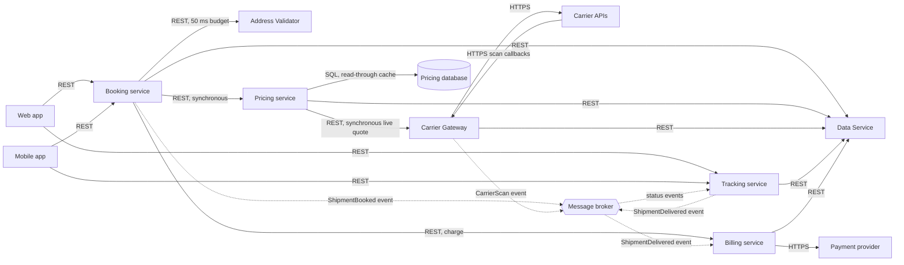

# Parcel booking v2

Proposal for the target architecture of parcel booking at Acme Logistics.

- Authors: Jelena Savkov (booking team), Bojan Ostojin (platform team)
- Reviewers: Ivana Kerac (billing team), Milan Tadin (commercial team)
- Revision: 2, after the first review on 2026-10-30
- Decisions: the ADRs in `design/adr/`
- Quality goals: `design/quality-goals.md`

## 1. Why a second version

Today parcels are booked in the counter app, one .NET application that books, prices, tracks and invoices in one deployable with one database.
Four teams change it, and every release waits for all four.
Customers can book only at a counter or by phone.
They ask to book on the web and in a mobile app, and to see the price before they pay.

Parcel booking v2 splits the counter app into services, each owned by one team, and adds a Web app and a Mobile app for customers.
The counter staff move to the Web app as well.
Nothing is built yet: this proposal and its ADRs are reviewed first.

## 2. Goals and non-goals

Goals:

- Customers book a parcel themselves, on the web or in the mobile app.
- Customers see an estimate from the tariff while they fill in the form, and the final price, with the carrier's live quote, in the confirmation.
- Each team releases its service on its own schedule (ADR-0001).
- Customers follow their parcel from booking to delivery.
- Invoices are issued without work at the counter.

Non-goals:

- Changing the tariffs or the carrier contracts.
- Warehouse and route planning, which stay in the fleet platform.
- A new payment provider: the current one stays.

## 3. Users and outside systems

| Who | What they do |
|---|---|
| Customers | Book, pay and follow parcels in the Web app or the Mobile app |
| Counter staff | Book for walk-in customers in the Web app and print labels |
| Commercial team | Set the tariffs in the admin page of the Pricing service |
| Finance | Follow invoices and payments |

Outside systems:

- **Carrier APIs**: the quote, label and scan APIs of the three carriers Acme works with, Brzopak, Kolibri Kurir and Tranzit Plus.
- **Payment provider**: charges cards and sends payment notices to the Billing service.
- **Postal register**: the list of streets and house numbers that the Address Validator loads every night.

## 4. Components

| Component | Responsibility | Team |
|---|---|---|
| Web app | Booking, tracking and invoices in the browser, for customers and counter staff | booking |
| Mobile app | The same for customers on Android and iOS | booking |
| Booking service | Takes a booking, checks the address, gets the price and confirms the booking | booking |
| Pricing service | Prices a parcel from Acme's tariffs and the carrier's live quote | pricing |
| Carrier Gateway | Talks to the carriers: quotes, labels and scans | pricing |
| Tracking service | Keeps the status of every shipment and serves the tracking page | tracking |
| Billing service | Charges the customer, issues invoices and follows payments | billing |
| Data Service | Stores the data of the services behind one REST API | data |
| Address Validator | Checks a delivery address against the postal register and normalizes it | booking |
| Message broker | Carries events between the services | platform |

## 5. Parts and calls

Solid arrows are synchronous calls over REST or HTTPS.
Dotted arrows are events through the message broker.

## 6. The components

### Booking service

The Booking service owns the booking flow (section 7.1).
It takes a booking from the Web app or the Mobile app, checks the address, gets the price and confirms the booking.
The Booking service writes `bookings` and `customers` through the Data Service.
It is the only service the clients call to book.

### Pricing service

The Pricing service prices a parcel.
A price is Acme's tariff for the weight and the zone, plus the carrier's live quote for this parcel.
For the estimate on the booking form the Pricing service uses the tariff alone.
Business customers with a contract get their contract discount, which the Pricing service reads from `customers` through the Data Service.

The Pricing service has its own database, the Pricing database, with one table, `tariffs`.
No other service reads or writes it.

The Pricing service reads tariffs through a read-through cache that keeps each tariff for 15 minutes.
A tariff change can therefore take up to 15 minutes to reach quotes: quotes are eventually consistent with the tariff table.
The commercial team accepted this on 2026-10-29, because tariffs change at most once a week and take effect on the following Monday.

### Carrier Gateway

The Carrier Gateway is the only part that talks to the carriers.
The Carrier Gateway calls the Carrier APIs of Brzopak, Kolibri Kurir and Tranzit Plus over HTTPS and turns their answers into one format.
The response time of the Carrier APIs for a live quote is 400–800 ms, depending on the carrier and the time of day.
The carriers send scans back to the Carrier Gateway as HTTPS callbacks.
The Carrier Gateway publishes a `CarrierScan` event to the message broker for every scan.
The Carrier Gateway writes each label to `labels` through the Data Service.

### Tracking service

The Tracking service keeps the status of every shipment and serves the tracking page of the Web app and the Mobile app.
The Tracking service receives every status change of a shipment as an event from the message broker.
The Tracking service creates the shipment in `shipments` when `ShipmentBooked` arrives (section 7.2).

### Billing service

The Billing service charges the customer's card through the Payment provider, issues invoices and follows payments (section 7.3).
The Billing service writes `payments` and `invoices` through the Data Service.

### Data Service

The Data Service owns every table of the platform except the tariff table of the Pricing service (ADR-0002).
Services have no schemas of their own: every service reads and writes its data through the REST API of the Data Service.
The data team runs the Data Service and makes every change to it.
A new table, a new column or a new query is a request in the data team's backlog, released with the Data Service every two weeks.

### Address Validator

The Address Validator checks a delivery address against the postal register and returns it in a normal form.
It keeps the register in memory and loads a new copy every night.
The Booking service calls the Address Validator synchronously with a time budget of 50 ms.
If the Address Validator has not answered within 50 ms, the Booking service accepts the address as typed and marks the booking for an address check by the counter staff.
A slow Address Validator therefore never delays a booking by more than 50 ms.

### Message broker

The message broker carries the events of section 9 between the services.
The platform team runs it.

### Web app and Mobile app

The Web app and the Mobile app call the Booking service over REST to book and to see bookings.
For the tracking page they call the Tracking service over REST.
Counter staff use the Web app with a counter role, which adds label printing.

## 7. Flows

### 7.1 Book a parcel

1. The customer fills in the booking form in the Web app or the Mobile app and presses Book.
2. The client sends the booking to the Booking service over REST.
3. The Booking service calls the Address Validator (budget 50 ms, section 6).
4. The Booking service calls the Pricing service synchronously over REST and waits for the final price.
5. The Pricing service reads the tariff and calls the Carrier Gateway synchronously for a live quote.
6. The Carrier Gateway gets the live quote from the Carrier APIs of the chosen carrier and returns it.
7. The Booking service writes the booking to `bookings` through the Data Service.
8. The Booking service publishes `ShipmentBooked` to the message broker.
9. The Booking service sends the confirmation, with the booking number and the final price, to the client.

### 7.2 Track a parcel

1. The Tracking service receives `ShipmentBooked` from the message broker and creates the shipment in `shipments`.
2. The carriers send scans to the Carrier Gateway, which publishes a `CarrierScan` event for each scan.
3. The Tracking service receives the `CarrierScan` events and updates `shipments.status` to in transit or delivered.
4. When a parcel is delivered, the Tracking service publishes `ShipmentDelivered`.
5. The Web app and the Mobile app show the status from the Tracking service.

### 7.3 Charge and invoice

1. After the confirmation is sent, the Booking service calls the Billing service to charge the customer's card.
2. The Billing service charges the card through the Payment provider and records the charge.
3. When the Billing service receives `ShipmentDelivered`, it issues the invoice and writes it to `invoices`.
4. When the invoice is issued, the Billing service sets `shipments.status` to invoiced.
5. When the payment notice arrives from the Payment provider, the Billing service sets `shipments.status` to paid.

If the charge call times out after 2 seconds, the Booking service retries the charge, up to three times.
If the charge still fails after the retries, the booking stays confirmed and the Billing service e-mails the customer a payment link.
A customer is never charged twice for one booking.

### 7.4 Change a tariff

1. The commercial team enters the new tariff in the admin page of the Pricing service.
2. The Pricing service writes it to `tariffs` in the Pricing database.
3. Quotes use the new tariff once the cached copy has expired, at the latest 15 minutes later.

## 8. Data ownership

| Data | Stored in | Written by | Read by |
|---|---|---|---|
| `bookings` | Data Service | Booking service | Tracking service, Billing service |
| `customers` | Data Service | Booking service | Pricing service, Billing service |
| `shipments` | Data Service | Tracking service | Booking service, Billing service |
| `shipments.status` | Data Service | Tracking service, Billing service | Web app, Mobile app, Booking service |
| `labels` | Data Service | Carrier Gateway | Tracking service |
| `payments` | Data Service | Billing service | Billing service |
| `invoices` | Data Service | Billing service | Web app, Mobile app |
| `tariffs` | Pricing database | Pricing service | Pricing service |

Every write goes through the Data Service API, except `tariffs`, which only the Pricing service touches.

## 9. Events

| Event | Published by | Consumed by |
|---|---|---|
| `ShipmentBooked` | Booking service | Tracking service |
| `CarrierScan` | Carrier Gateway | Tracking service |
| `ShipmentDelivered` | Tracking service | Billing service |

Every event carries the shipment number, the time it happened and a payload in JSON.
The Tracking service relies on the message broker to deliver the events of one shipment in the order they were published.
Without that order a late `CarrierScan` for in transit could arrive after delivered and move a delivered parcel back to in transit.
Which broker product we run is to be decided later (ADR-0004).

## 10. Interfaces

| Service | Endpoint | Used by |
|---|---|---|
| Booking service | `POST /bookings` | Web app, Mobile app |
| Booking service | `GET /bookings/{id}` | Web app, Mobile app |
| Booking service | `POST /estimates` | Web app, Mobile app |
| Pricing service | `POST /estimates` | Booking service |
| Pricing service | `POST /quotes` | Booking service |
| Carrier Gateway | `POST /quotes` | Pricing service |
| Tracking service | `GET /shipments/{number}` | Web app, Mobile app |
| Billing service | `POST /charges` | Booking service |
| Billing service | `GET /invoices` | Web app, Mobile app |
| Data Service | `GET` and `PATCH /tables/{table}` | every service |
| Address Validator | `POST /check` | Booking service |

All endpoints take and return JSON.
Breaking changes get a new version in the path, and the old version stays until every client has moved.

## 11. Security

Customers sign in with their Acme account through OpenID Connect; counter staff sign in with their staff account.
Services call each other with short-lived service tokens issued by the platform's identity server.
Card numbers never reach Acme: the Payment provider keeps the cards and the Billing service stores only a payment token.
Personal data stays in the Data Service, and the Pricing database holds none.

## 12. Operations

Every service runs in a container on the platform team's cluster.
Logs and traces go to the platform's log store, and each service exposes a health endpoint.
The teams are on call for their own services during office hours, and the platform team covers nights and weekends.

## 13. Rollout

1. January 2027: all services go live for the Web app at three counters in Novi Sad.
2. March 2027: customers in Novi Sad and Belgrade can book in the Web app.
3. May 2027: the Mobile app, and every counter moves to the Web app.
4. June 2027: the counter app is switched off.

Each step starts only after the previous one has run for four weeks without a severe incident.
Until June 2027 the counter app stays ready to take bookings again.

## 14. Alternatives considered

- Keep the counter app and add a web front end: rejected, because the four teams would still release together (ADR-0001).
- Buy a booking product: rejected, because none of the products we looked at works with all three carriers.

## 15. Risks

- The teams have not run a message broker before.
- The counter staff need training on the Web app before the first rollout step.
- The carriers change their APIs a few times a year, and only the pricing team follows those changes.

## 16. Open questions

- Does label printing at the counter move from the counter app to the Carrier Gateway?
- Who answers customers about a charge outside office hours?
- Do cash payments at the counter go through the Billing service as well?

## 17. Words used here

| Word | Meaning |
|---|---|
| Booking | A customer's order to send one parcel |
| Shipment | The parcel on its way, from the first scan to delivery |
| Quote | The carrier's price for one parcel, asked at the moment of booking |
| Tariff | Acme's own price list by weight and zone |
| Scan | A carrier's record that a parcel passed a point |
| Label | The carrier's address label with its tracking number |

## 18. Changes in revision 2

- Added the time budget of the Address Validator and what the Booking service does when it is exceeded.
- Added the read-through cache for tariffs and the staleness the commercial team accepted.
- Added retries of the charge call when it times out.
